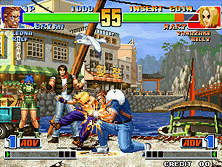
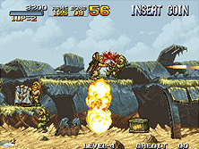
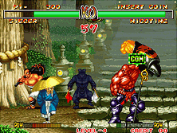
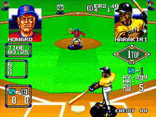

<div align="center">


# Neo-Geo Web Port

### Your Neo Geo library, redesigned for the browser.

[](https://github.com/AliAl-ojeely/Neo-Geo-Web)
[](https://github.com/EmulatorJS/EmulatorJS)
[](https://github.com/finalburnneo/FBNeo)
[](#game-compatibility)
[](#english--arabic)
[](LICENSE)

<br>

**Neo-Geo Web Port** is an independent, bilingual, dark-themed frontend for browsing and launching a private Neo Geo game library using **EmulatorJS + FBNeo/WebAssembly**. Its public website is a static frontend; users choose their own legally obtained game and BIOS files.

**Status: Active development · Partial validation · Noncommercial core restrictions apply**

[**Source code**](https://github.com/AliAl-ojeely/Neo-Geo-Web) · [**Setup guide**](#installation--local-development) · [**Browser help**](#browser-compatibility--saved-library-access) · [**Game catalog**](#127-boot-verified-catalog-titles) · [**Report an issue**](https://github.com/AliAl-ojeely/Neo-Geo-Web/issues)

</div>

---

## Game Preview Gallery

Four featured games from the project's local Neo Geo catalog. The images are included in the README **only after** the corresponding local previews have been imported into `assets/readme/` and permission to publish them has been confirmed.

<div align="center">

<table>
  <tr>
    <td align="center" width="50%"><br><strong>The King of Fighters ’98</strong></td>
    <td align="center" width="50%"><br><strong>Metal Slug</strong></td>
  </tr>
  <tr>
    <td align="center" width="50%"><br><strong>Samurai Shodown II</strong></td>
    <td align="center" width="50%"><br><strong>Baseball Stars 2</strong></td>
  </tr>
</table>

<sub>Game names, characters, and artwork belong to their respective rightsholders. Preview imagery is not bundled with the application source by default.</sub>

</div>

---

## What's Inside v0.1.5.1

| Area | Capabilities |
| :--- | :--- |
| **The library** | Search, categories, favorites, previews, catalog-driven game launch, and a rescan/reconnect workflow |
| **The player** | EmulatorJS 4.2.3, pinned FBNeo WebAssembly, BIOS selection policy, runtime diagnostics, and `Tab` pause/resume |
| **Local sources** | Browser file pickers plus an optional loopback-only Python companion for persistent directory references |
| **Controls** | Two-player keyboard layout, customizable bindings, and simultaneous multi-button macro shortcuts |
| **Languages** | English by default, Arabic as an option, RTL/LTR layouts, and saved display-language preferences |
| **UI design** | Responsive Pitch Black design, clean cards, game previews, guided first-run setup, and accessible dialogs |
| **Quality checks** | Node.js/Python regression tests, static build verification, and a GitHub Pages asset audit |

### Current progress

| Metric | Evidence-based status |
| :--- | :--- |
| **127 games** | Historically recorded with `BOOT PASS` and included in the active catalog |
| **64 more candidates** | Deferred for further compatibility, archive, or driver investigation |
| **191 candidates total** | Original assessment scope (not all listed on the active public catalog) |
| **Complete gameplay** | **Not verified across all 127 games**; boot success is not a guarantee of playable sessions |
| **Public hosting** | GitHub Pages preparation is available; the published deployment requires its own acceptance checks |

---

## Key Features

### 🎮 Local library and discovery

Browse titles by genre, search by game name or ROM filename, inspect image previews, and keep favorites. The catalog maps a game to a selected ROM identity and known metadata. Selecting a game does not require uploading ROM data to a remote application server.

### 🗂️ ROM, PREVIEWS, and BIOS linking

The **Local Library Manager** can link three separate source types: local ROM ZIP files, preview images, and a valid inner `neogeo.zip`. Source availability and hash/size checks are part of the launch path where applicable. The **Rescan** action can request fresh listings from the local companion instead of merely reusing an in-memory inventory.

### ⌨️ Custom two-player controls

Keyboard assignments can be changed and persisted locally. The default profile includes fighting-game-friendly combined-button macros with safeguards for overlapping key presses and releases. It does **not** modify ROM files or the underlying third-party core.

### English & Arabic

The first-party interface uses `web/languages.js` for translations. A new user sees **English** by default; selecting **Arabic** switches the interface to RTL. The chosen language is restored on later visits to the same browser origin. The website language and EmulatorJS's own internal menu language are **separate settings**.

### 🔒 Privacy-conscious design

ROMs and BIOS files are provided by the user. The generated static site includes app code and public metadata, not the user's commercial game library. Optional localhost integration is not a remote cloud service. Browser storage is specific to the origin, browser, and profile used.

---

## Technology Stack

| Component | Technology / implementation |
| :--- | :--- |
| **Browser frontend** | HTML5, CSS3, vanilla JavaScript |
| **Web emulation runtime** | Pinned EmulatorJS `4.2.3` |
| **Emulator core** | Pinned FBNeo/WebAssembly build with documented BIOS-related patches |
| **Local tooling** | Python, project CLI (`manage.py`), loopback-only companion |
| **Storage** | Local browser preferences, IndexedDB and browser-dependent filesystem handles |
| **Localization** | Centralized `web/languages.js`, English/Arabic, LTR/RTL |
| **Controls** | RetroPad mapping and keyboard macro adapter |
| **Testing** | Node.js test runner, Python unittest, local HTTP and distribution verification |
| **Hosting target** | GitHub Pages (static output from `dist/github-pages/`) |
| **Licensing** | First-party GPL-3.0-or-later additions; separate EmulatorJS/FBNeo/other component terms |

---

## Project Architecture

```text
Neo-Geo-Web/
├── .github/
│   └── workflows/                 # Static validation and manually triggered Pages workflow
├── app/                            # Catalog, build, release and diagnostic Python modules
├── assets/                         # Repository visuals and README screenshot assets
│   └── readme/                     # Optional authorized gameplay previews for README
├── docs/                           # Guides, implementation notes, and release reports
├── tests/                          # JS/CJS and Python regression tests
├── tools/                          # Local companion, preview and preflight tools
├── web/                            # First-party frontend source
│   ├── controls/                   # Custom controls, UI and Tab pause
│   ├── data/catalog.json           # 127 boot-verified catalog entries and identities
│   ├── library/                    # Source linking, storage, validation and recovery
│   ├── media/                      # Frontend icon/logo assets
│   ├── ui/                         # Shared message boxes and site interactions
│   ├── index.html                  # Library home page
│   ├── player.html                 # Emulator/player page
│   ├── settings.html               # Settings and language selectors
│   ├── app.js                      # Library UI application
│   ├── player.js                   # Emulator integration
│   ├── settings.js                 # Settings and controls integration
│   ├── languages.js                # Central bilingual translation catalog
│   └── style.css                   # Shared visual design
├── vendor/                         # Third-party code/core (redistribution review required)
├── dist/github-pages/              # Generated static build; do not edit directly
├── backups/                         # LOCAL-ONLY backups; never publish
├── manage.py                       # Main Python CLI
├── LICENSE
├── THIRD_PARTY_NOTICES.md
└── README.md
```

Some paths are local-only or generated. A source-only checkout may not contain all developer assets or third-party binaries; the runtime build requires the appropriate pinned dependencies.

---

## Installation & Local Development

### 1. Clone the source

```powershell
git clone https://github.com/AliAl-ojeely/Neo-Geo-Web.git
Set-Location .\Neo-Geo-Web
```

You can use any local checkout directory; the repository name does not need to match your Windows development folder.

### 2. Run the tests

```powershell
py -3 manage.py test
node --test tests/*.test.cjs
```

### 3. Build and verify the website

```powershell
py -3 manage.py web build
py -3 manage.py web verify
py -3 manage.py github audit
```

The generated website appears in `dist/github-pages/`. The audit checks selected privacy and artifact integrity conditions; it is **not** a substitute for confirming distribution rights.

### 4. Preview locally

```powershell
py -3 tools/static_preview_v015.py
```

Open the URL printed in the terminal. This serves the generated static files but does not automatically connect your library folders.

### 5. Optional persistent local companion

Configure paths for files you are legally permitted to use:

```powershell
py -3 tools/local_companion_v032.py configure --roms "D:\NeoGeo\ROMs" --previews "D:\NeoGeo\PREVIEWS" --bios "D:\NeoGeo\BIOS"
py -3 -u tools/local_companion_v032.py serve --port 8777
```

Then open `http://127.0.0.1:8777/Neo-Geo-Web/`. The companion is bound to loopback and should **not** be exposed to the internet. It uses local machine configuration and cannot run inside GitHub Pages.

**Note:** A public GitHub Pages visitor must select their own files through available browser APIs. Library permissions and preferences do not transfer automatically from `localhost` to `github.io` because the origin changes.

---

## Browser Compatibility & Saved Library Access

**Browser testing scope (Windows):** The project has been tested with **Google Chrome, Brave, and Microsoft Edge**. These are the only browsers in the project's reported manual browser-testing scope so far; the Node.js/Python tests are not a substitute for browser-by-browser gameplay verification. **Firefox, Safari, Opera, Vivaldi, and other browsers have not been verified**. Additional browser testing is planned for future releases. Support and permission behavior may also differ across browser versions, operating systems, and privacy settings.

### Why ROMs or BIOS might need to be selected again

The public [GitHub Pages site](https://alial-ojeely.github.io/Neo-Geo-Web/) **never bundles or uploads your ROMs or BIOS**. When a browser supports the native File System Access API, the Local Library Manager stores your selected ROMs, PREVIEWS, and BIOS file/folder handles in the site's **IndexedDB**. However, saving a handle is **not the same as granting permanent permission**: browsers may require renewed read permission after restarting, and private sessions, cleared site data, or ordinary file-input fallback selections may not persist.

**First-time setup:** Open the public website, choose your own ROMs folder and matching `neogeo.zip` BIOS (and optionally PREVIEWS), then click **Save Library**. On subsequent visits, do **not** immediately select the paths again. If the source cards say **Permission renewal required**, click **Reconnect Saved Sources** and approve access to the already-saved sources. When your browser offers **Allow on every visit**, choose it if you want recurring access on this device. You can later revoke permissions in your browser's site settings. If the cards say the sources are missing rather than requiring permission, see the checks below.

| Browser | Tested scope | Reopening the saved library |
| :--- | :--- | :--- |
| **Google Chrome** | Tested on Windows | Supports saving native handles; the **Allow on every visit** permission resolved the repeated-selection issue in project testing. If prompted, use **Reconnect Saved Sources** and choose that option. |
| **Brave** | Tested on Windows | Some versions disable the native File System Access API by default, causing temporary session-only selection. See the Brave steps below. Once enabled, select the folders and **Save Library** again; permanent access depends on the browser's available permission options. |
| **Microsoft Edge** | Included in the Windows browser testing scope | Uses Chromium file-access permissions. Select and save sources, reconnect when needed, and use persistent permission if Edge offers it. This is **not a guarantee** that every Edge version will retain permission permanently. |
| **Firefox, Safari, and other browsers** | **Not tested / not verified** | Compatibility, native directory-picker support, and saved permission behavior remain unverified. The site may fall back to session-only file selection. |

### Brave: enable native directory access when unavailable

1. Open `brave://flags/#file-system-access-api` in Brave's address bar.
2. If **File System Access API** is available and currently **Default** or **Disabled**, change it to **Enabled**, then click **Relaunch**. This is an **experimental browser-wide setting** and may affect security/privacy; enable it only if you accept that trade-off. The flag may be absent or behave differently in some Brave versions.
3. Reopen the GitHub Pages website; select ROMs, PREVIEWS (optional), and BIOS; click **Save Library**.
4. Close and reopen the browser to test persistence. If permission is requested again, use **Reconnect Saved Sources** and choose a persistent/always-allow option **only if Brave provides one**.

### Chrome and Edge: prefer persistent site permission

1. After saving your sources, reopen the website. If a file-access prompt lists previously selected files/folders, select **Allow on every visit** when available, rather than **Allow this time**.
2. If the site shows **Permission renewal required**, click **Reconnect Saved Sources**. This should request access to saved handles without opening the original folder picker.
3. Check that your browser is **not clearing site data on exit** for `alial-ojeely.github.io`; avoid private/incognito sessions for persistent library setup. Do not clear this site's IndexedDB unless you intend to forget the saved references.

**Troubleshooting:** If source cards show **Not connected**, check whether your browser exposes `window.showDirectoryPicker` and `window.showOpenFilePicker` (both should be functions for native selection). If they are unavailable, the site's fallback file input only lasts for that session. **Protect Browser Storage** can request more durable storage, but does **not** grant file-system permission. Permissions are browser-, profile-, and origin-specific: granting access in Chrome does not automatically grant it in Brave or Edge, and `localhost` settings do not migrate to GitHub Pages.

**References:** [Chrome persistent permissions](https://developer.chrome.com/blog/persistent-permissions-for-the-file-system-access-api) · [File System Access API](https://developer.chrome.com/docs/capabilities/web-apis/file-system-access) · [Brave compatibility discussion](https://github.com/brave/brave-browser/issues/29411)

---

## Keyboard Controls

| Action | Player 1 | Player 2 |
| :--- | :---: | :---: |
| Up / down / left / right | Arrow keys | NumPad `8` / `2` / `4` / `6` |
| Neo Geo A | `A` | `J` |
| Neo Geo B | `S` | `K` |
| Neo Geo C | `D` | `L` |
| Neo Geo D | `F` | `P` |
| A+B | `Q` | `Y` |
| A+B+C | `R` | `U` |
| C+D | `E` | `I` |
| START | `1` | `2` |
| COIN / SELECT | `3` | `4` |

`W` and `O` are intentionally unassigned in the default profiles. The `Tab` key controls the project's pause/resume overlay while playing. Specific move effects vary by game; mapping A–D to light/heavy attacks describes titles such as *The King of Fighters ’98*, not every game.

---

## Game Compatibility

The catalog currently contains **127 titles with a historical `BOOT PASS` result**. This is the project's **boot-verified active catalog**, not a claim that all 127 games have passed full playthroughs, input, graphics and audio validation. The original assessment tracked **191 candidates**; the remaining **64** are deferred for additional compatibility work. The game's `game_compatibility` metadata is still `NOT VERIFIED` for most active titles.

### 127 Boot-Verified Catalog Titles

The entries below were extracted from `web/data/catalog.json`, retaining the project's actual titles and driver identifiers. Open any category to see every title. These groupings reflect the catalog's classifications, not necessarily original publisher genres.

<details>
<summary><strong>Fighting — 37 games</strong></summary>

| Game title | ROM / driver ID | Current evidence |
| :--- | :--- | :--- |
| Aggressors of Dark Kombat | `aodk` | Boot PASS only |
| Art of Fighting | `aof` | Boot PASS only |
| Art of Fighting 2 | `aof2` | Boot PASS only |
| Art of Fighting 3 | `aof3` | Boot PASS only |
| Breakers | `breakers` | Gameplay check recorded |
| Breakers Revenge | `breakrev` | Boot PASS only |
| Double Dragon | `doubledr` | Boot PASS only |
| Fatal Fury | `fatfury1` | Boot PASS only |
| Fatal Fury 2 | `fatfury2` | Boot PASS only |
| Fatal Fury 3 | `fatfury3` | Boot PASS only |
| Fatal Fury Special | `fatfursp` | Boot PASS only |
| Galaxy Fight | `galaxyfg` | Boot PASS only |
| Kabuki Klash | `kabukikl` | Boot PASS only |
| Karnov’s Revenge | `karnovr` | Boot PASS only |
| Kizuna Encounter | `kizuna` | Boot PASS only |
| Ninja Master’s | `ninjamas` | Boot PASS only |
| Ragnagard | `ragnagrd` | Boot PASS only |
| Real Bout Fatal Fury | `rbff1` | Boot PASS only |
| Real Bout Fatal Fury 2 | `rbff2` | Boot PASS only |
| Real Bout Fatal Fury Special | `rbffspec` | Boot PASS only |
| Samurai Shodown | `samsho` | Boot PASS only |
| Samurai Shodown II | `samsho2` | Boot PASS only |
| Samurai Shodown IV | `samsho4` | Boot PASS only |
| Savage Reign | `savagere` | Boot PASS only |
| The King of Fighters 2001 | `kof2001` | Boot PASS only |
| The King of Fighters 2002 | `kof2002` | Boot PASS only |
| The King of Fighters ’94 | `kof94` | Boot PASS only |
| The King of Fighters ’95 | `kof95` | Boot PASS only |
| The King of Fighters ’96 | `kof96` | Boot PASS only |
| The King of Fighters ’97 | `kof97` | Boot PASS only |
| The King of Fighters ’97 · Mod | `kof97-5a` | Boot PASS only |
| The King of Fighters ’98 | `kof98` | Boot PASS only |
| Waku Waku 7 | `wakuwak7` | Boot PASS only |
| World Heroes | `wh1` | Boot PASS only |
| World Heroes 2 | `wh2` | Boot PASS only |
| World Heroes 2 Jet | `wh2j` | Boot PASS only |
| World Heroes Perfect | `whp` | Boot PASS only |

</details>

<details>
<summary><strong>Action — 24 games</strong></summary>

| Game title | ROM / driver ID | Current evidence |
| :--- | :--- | :--- |
| Blue’s Journey | `bjourney` | Boot PASS only |
| Burning Fight | `burningf` | Boot PASS only |
| Cyber-Lip | `cyberlip` | Boot PASS only |
| Eight Man | `eightman` | Boot PASS only |
| Ganryu | `ganryu` | Boot PASS only |
| King of the Monsters | `kotm` | Boot PASS only |
| King of the Monsters 2 | `kotm2` | Boot PASS only |
| Magician Lord | `maglord` | Boot PASS only |
| Metal Slug | `mslug` | Gameplay check recorded |
| Metal Slug 2 | `mslug2` | Boot PASS only |
| Mutation Nation | `mutnat` | Boot PASS only |
| Neo Bomberman | `neobombe` | Boot PASS only |
| Ninja Combat | `ncombat` | Boot PASS only |
| Ninja Commando | `ncommand` | Boot PASS only |
| Robo Army | `roboarmy` | Boot PASS only |
| Sengoku | `sengoku` | Boot PASS only |
| Sengoku 2 | `sengoku2` | Boot PASS only |
| Shock Troopers | `shocktro` | Boot PASS only |
| Shock Troopers: 2nd Squad | `shocktr2` | Boot PASS only |
| Spin Master | `spinmast` | Boot PASS only |
| The Last Blade | `lastblad` | Boot PASS only |
| The Last Blade 2 | `lastbld2` | Boot PASS only |
| The Super Spy | `superspy` | Boot PASS only |
| Top Hunter | `tophuntr` | Boot PASS only |

</details>

<details>
<summary><strong>Shooters — 12 games</strong></summary>

| Game title | ROM / driver ID | Current evidence |
| :--- | :--- | :--- |
| Aero Fighters 2 | `sonicwi2` | Boot PASS only |
| Aero Fighters 3 | `sonicwi3` | Boot PASS only |
| Alpha Mission II | `alpham2` | Boot PASS only |
| Blazing Star | `blazstar` | Boot PASS only |
| Ghost Pilots | `gpilots` | Boot PASS only |
| Last Resort | `lresort` | Boot PASS only |
| NAM-1975 | `nam1975` | Boot PASS only |
| Prehistoric Isle 2 | `preisle2` | Boot PASS only |
| Strikers 1945 Plus | `s1945p` | Boot PASS only |
| Twinkle Star Sprites | `twinspri` | Boot PASS only |
| Viewpoint | `viewpoin` | Boot PASS only |
| Zed Blade | `zedblade` | Boot PASS only |

</details>

<details>
<summary><strong>Sports — 22 games</strong></summary>

| Game title | ROM / driver ID | Current evidence |
| :--- | :--- | :--- |
| 2020 Super Baseball | `2020bb` | Boot PASS only |
| 3 Count Bout | `3countb` | Boot PASS only |
| Baseball Stars 2 | `bstars2` | Boot PASS only |
| Baseball Stars Professional | `bstars` | Boot PASS only |
| Goal! Goal! Goal! | `goalx3` | Boot PASS only |
| Jockey Grand Prix | `jockeygp` | Boot PASS only |
| League Bowling | `lbowling` | Boot PASS only |
| Neo Drift Out | `neodrift` | Boot PASS only |
| Neo Turf Masters | `turfmast` | Boot PASS only |
| Over Top | `overtop` | Boot PASS only |
| Pleasure Goal | `pgoal` | Gameplay check recorded |
| Power Spikes II | `pspikes2` | Boot PASS only |
| Riding Hero | `ridhero` | Boot PASS only |
| Soccer Brawl | `socbrawl` | Boot PASS only |
| Stakes Winner | `stakwin` | Boot PASS only |
| Stakes Winner 2 | `stakwin2` | Boot PASS only |
| Super Sidekicks | `ssideki` | Boot PASS only |
| Super Sidekicks 2 | `ssideki2` | Boot PASS only |
| Super Sidekicks 3 | `ssideki3` | Boot PASS only |
| The Ultimate 11 | `ssideki4` | Boot PASS only |
| Top Player’s Golf | `tpgolf` | Boot PASS only |
| Windjammers | `wjammers` | Boot PASS only |

</details>

<details>
<summary><strong>Puzzles — 9 games</strong></summary>

| Game title | ROM / driver ID | Current evidence |
| :--- | :--- | :--- |
| Bang Bead | `bangbead` | Boot PASS only |
| Captain Tomaday | `ctomaday` | Boot PASS only |
| Magical Drop II | `magdrop2` | Gameplay check recorded |
| Magical Drop III | `magdrop3` | Boot PASS only |
| Panic Bomber | `panicbom` | Boot PASS only |
| Pop ’n Bounce | `popbounc` | Boot PASS only |
| Puzzle Bobble | `pbobblen` | Boot PASS only |
| Puzzle Bobble 2 | `pbobbl2n` | Boot PASS only |
| Puzzle de Pon! | `puzzledp` | Boot PASS only |

</details>

<details>
<summary><strong>Other — 23 games</strong></summary>

| Game title | ROM / driver ID | Current evidence |
| :--- | :--- | :--- |
| Bakatonosama Mahjong Manyuki | `bakatono` | Boot PASS only |
| Bang Bang Busters | `bbbuster` | Boot PASS only |
| Crouching Tiger Hidden Dragon | `cnbe` | Boot PASS only |
| fbfrenzy | `fbfrenzy` | Boot PASS only |
| frogfest | `frogfest` | Boot PASS only |
| Ghostlop | `ghostlop` | Boot PASS only |
| joyjoy | `joyjoy` | Boot PASS only |
| ltorb1 | `ltorb1` | Boot PASS only |
| marukodq | `marukodq` | Boot PASS only |
| minasan | `minasan` | Boot PASS only |
| mosyougi | `mosyougi` | Boot PASS only |
| ncolumns | `ncolumns` | Boot PASS only |
| neonopon | `neonopon` | Boot PASS only |
| neopong | `neopong` | Boot PASS only |
| poknight | `poknight` | Boot PASS only |
| quizdai2 | `quizdai2` | Boot PASS only |
| quizdais | `quizdais` | Boot PASS only |
| quizkof | `quizkof` | Boot PASS only |
| sdodgeb | `sdodgeb` | Boot PASS only |
| trally | `trally` | Boot PASS only |
| tws96 | `tws96` | Boot PASS only |
| vliner | `vliner` | Boot PASS only |
| zintrkcd | `zintrkcd` | Boot PASS only |

</details>

### Still under investigation

The **64 deferred candidates** have not been added to the active catalog. Further research includes ROM composition and dependencies, driver mapping, BIOS compatibility, boot validation, and real-browser play testing. They will be added only after evidence supports the change. **No date or blanket compatibility guarantee is implied.**

---

## Validation & Maintenance

Development workflows include:

- JavaScript syntax validation and Node.js tests covering keyboard inputs, macro overlaps, localization, player layout, saved sources and recovery.
- Python tests for installer safety, companion routes, path validation, and local HTTP behavior.
- `manage.py web build`, `manage.py web verify`, and `manage.py github audit` for static artifacts.
- Manual browser acceptance for actual gameplay, visuals, audio, and user permissions.

**What the checks do not prove:** entire-game compatibility, permission persistence in every browser, flawless audio/video, or redistribution eligibility for binaries.

If a game does not start, verify the correct ROM and BIOS, review the available diagnostics, and open an [issue](https://github.com/AliAl-ojeely/Neo-Geo-Web/issues) with a reproducible description. Do not attach ROMs, BIOS, save states with private information, or copyrighted preview collections.

---

## AI-Assisted Analysis & Development

**Artificial intelligence supported parts of this project's engineering and analysis**, especially the work of studying how the classic emulator environment, ROM/BIOS relationships, and a modern WebAssembly browser frontend fit together.

AI-assisted tasks included:

- Inspecting emulator integration paths and explaining how EmulatorJS, FBNeo, browser memory and the player interface interact.
- Examining ROM layouts, driver identifiers, archive dependencies, file sizes and checksums to guide compatibility testing.
- Helping design repeatable boot checks, regression tests and diagnostic reporting across many game candidates.
- Comparing test outcomes, identifying suspicious source-handling behavior, and supporting debugging of permissions, session recovery and game launch.
- Organizing code into readable modules, documenting functions in English and assisting with English/Arabic localization.
- Reviewing build outputs, site packaging and privacy boundaries before GitHub deployment.

AI contributions are **assistive, not a replacement for the emulator core or independent validation**. The emulation engine comes from its credited third-party authors; project decisions, acceptance criteria, local testing, and final publication remain human responsibilities. Historical boot evidence does not establish full gameplay compatibility. **Additional games and known compatibility limitations are still being investigated and improved.**

---

## Privacy, Copyright & Redistribution

- The website **does not include ROMs, BIOS archives, or a downloadable game pack**.
- A file being available online, or having been modified, does **not** automatically grant redistribution rights.
- Game images displayed in this README must come from material the publisher is authorized to share; the preview import utility does not upload anything by itself.
- Never publish private configuration, browser storage exports, local backups, personal logs or save files.
- The first-party frontend additions are identified as **GPL-3.0-or-later**; EmulatorJS, FBNeo, RetroArch and embedded components retain their own terms.
- The pinned FBNeo component has **noncommercial restrictions** and requirements around source changes and redistribution. See `THIRD_PARTY_NOTICES.md` and the actual component licenses.
- Before a public binary release, verify complete corresponding-source availability, applicable embedded licenses and any required notices. A successful CI build or license badge is not legal clearance.

---

## Known Limitations & Roadmap

**Current limitations**

- Not all 191 historically investigated candidates can launch through the currently selected driver/archive path.
- Passing boot tests does not prove that gameplay, sound and controls are perfect for every listed title.
- Native folder access and persistence depend on browser permissions. Brave may require enabling the File System Access API flag; see [Browser Compatibility & Saved Library Access](#browser-compatibility--saved-library-access).
- GitHub Pages is static hosting: it cannot run the local Python companion or access a visitor's disk without user permission.
- Browser saved preferences and library handles are origin-specific.
- Public deployment, licensing and corresponding-source verification require separate acceptance before declaring an unconditional release.

**Planned improvements**

- Continue resolving the 64 deferred candidates with reproducible compatibility evidence.
- Expand real-game audio, input, rendering and save-state testing.
- Improve recovery and permission feedback in supported browsers.
- Polish localization, accessibility and mobile layout behavior.
- Maintain clear compatibility reports and safe public build checks.

---

## Developer & Contact

<div align="center">

**Ali Nasser Al-ojeely (Mr.Ghost)**
*Software Developer · Frontend & Emulator Integration*

[](https://github.com/AliAl-ojeely)
[](mailto:alialojeely@gmail.com)

**Suggestions and reproducible bug reports are welcome via [GitHub Issues](https://github.com/AliAl-ojeely/Neo-Geo-Web/issues).**

</div>

### Credits

- [EmulatorJS](https://github.com/EmulatorJS/EmulatorJS) — browser emulation framework/runtime.
- [FinalBurn Neo (FBNeo)](https://github.com/finalburnneo/FBNeo) — arcade emulator core.
- [libretro / RetroArch](https://github.com/libretro/RetroArch) — relevant ecosystem and dependencies.
- AI assistants — analysis, test support, source readability and documentation, under human review.

See [`LICENSE`](LICENSE) and [`THIRD_PARTY_NOTICES.md`](THIRD_PARTY_NOTICES.md) for the exact licensing scope.

---

<div align="center">

<sub>Neo-Geo Web Port is an independent fan/engineering project, not an official SNK product. All game names, trademarks and imagery belong to their respective owners. Compatibility and distribution eligibility depend on the specific assets and build.</sub>

</div>
